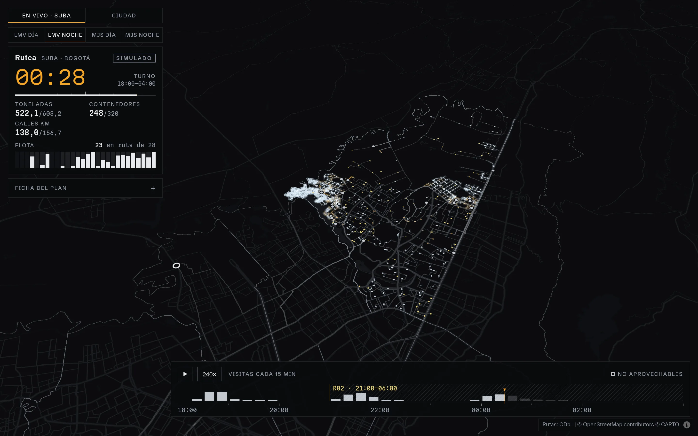

# ♻️ Rutea

> **A waste-collection microroute planner for Bogotá (pilot: Suba), built on a custom CVRP solver in Java 21, with live replanning and Colombian sanitation regulations as traceable constraints**

[](https://openjdk.org/)
[](https://spring.io/projects/spring-boot)
[](https://react.dev/)
[](https://postgis.net/)
[](LICENSE)
[](https://github.com/YmidOrtega/Rutea/actions/workflows/ci.yml)
[](http://vrp.galgos.inf.puc-rio.br/)



---

## 📖 Overview

**Rutea** decides which vehicle collects which containers, and in what order, on Suba's real streets (OpenStreetMap), respecting capacity, shifts, waste stream and the regulations of Colombia's public sanitation service. When something changes during operation (a breakdown, a closed road, an overflowing container), it replans on the fly and broadcasts the new plan to every client over WebSocket.

At its core is a **custom CVRP solver** (ALNS) with no dependencies, benchmarked against the public CVRPLIB instances. Everything else (road graph, domain, simulation, API and map) exists so that solver works on a real city and can be seen working.

### Perfect For
- 🧮 Seeing a vehicle-routing solver measured against the state of the art, not against itself
- 🗺️ Understanding how a real sanitation service translates into an optimization problem
- 🚨 Testing how a plan responds to a breakdown, a road closure or an overflow, live
- 💼 Portfolio showcase bridging environmental engineering and backend development

> ⚠️ **The streets are real; containers and their loads are simulated**, and the interface says so. Rutea is not connected to any operator's service.

---

## ✨ Key Features

- 🧠 **Custom CVRP solver** — ALNS (Shaw removal, regret-2, simulated annealing) over a local search that evaluates each move in O(1); pure Java, no optimization libraries
- ⚡ **Parallel and reproducible** — `alns-x4` runs four searches with fixed seeds; every run has an explicit seed
- 📏 **Benchmarked on CVRPLIB** — 0.18% average gap on 43 X instances of up to 301 nodes, versus 2.01% for Timefold with its default configuration
- 🛣️ **Real road graph** — 18,134 vertices and 2,227 km of OSM streets with one-way rules; a 1,701 × 1,701 matrix in 377 ms on 16 threads
- ⚖️ **Traceable regulations** — every constraint cites its decree and article (`NormRef`) and has a test; anything not verified against the official text is marked `PENDIENTE_VERIFICAR`
- 🔧 **Live replanning** — breakdowns (R05), road closures and overflowing containers, with a P99 of 124.6 ms to replan a breakdown
- 📡 **Simulated fill sensors** — a container that reaches 100% is dispatched automatically
- 🗄️ **PostgreSQL + PostGIS** — the shift's orders are replayed after a restart and every reported position is stored as a point (R08)
- 🌙 **Night dispatch dashboard** — React, MapLibre and deck.gl: the map lights up as the shift goes on

---

## 🚀 Quick Start

### Prerequisites
- Docker with Compose

### One command

```bash
git clone https://github.com/YmidOrtega/Rutea.git
cd Rutea
docker compose up
```

The first run downloads Suba's OpenStreetMap data (2 MB, verified by SHA-256) and builds the image; the plan is ready about 25 s after startup.

| Interface | URL |
|---|---|
| **Map** | http://localhost:8080 |
| **REST API** | http://localhost:8080/api |
| **Event WebSocket** | ws://localhost:8080/ws/events |

On the map: ▶ starts the shift, the triangle next to each compactor breaks it down, clicking a black container reports it as overflowing, and "Cerrar una vía" closes the street you click next.

---

## 🌐 REST API

```bash
# The shift's plan: routes, containers, sites and sectors
curl http://localhost:8080/api/plan

# Break down a compactor at the current clock time
curl -X POST http://localhost:8080/api/breakdowns \
  -H 'Content-Type: application/json' -d '{"truck":"C-03"}'

# Report an overflowing container
curl -X POST http://localhost:8080/api/overflows \
  -H 'Content-Type: application/json' -d '{"container":"N0033"}'

# Play the shared clock at 240×
curl -X PUT http://localhost:8080/api/clock \
  -H 'Content-Type: application/json' -d '{"running":true,"speed":240}'
```

Errors follow RFC 9457. The full contract is in [`docs/api.md`](docs/api.md) (in Spanish), and a test checks it against the code.

---

## 📊 Results

Every figure comes from the benchmark harness, with instance, seed, time limit and machine (i5-14400F, 16 threads, Java 21). The CSVs are in [`docs/benchmarks/`](docs/benchmarks/).

**Solver vs. CVRPLIB** — 43 X instances of 101 to 301 nodes, 60 s, seed 1:

| Solver | Average gap | Worst instance | Reaches the BKS |
|---|---:|---:|---:|
| **`alns-x4`, cold** | **0.18%** | 0.64% | 12 |
| `alns-x4`, warm | 0.19% | 0.93% | 8 |
| `alns` | 0.35% | 2.02% | 8 |
| Timefold 2.7.1, default configuration | 2.01% | 6.11% | 0 |

**Suba vs. a quadrant sweep** — the 806 non-recyclable containers, one truck per trip in both plans:

| Method | km | Hours | t CO₂ |
|---|---:|---:|---:|
| Sweep, 2 km quadrants (the best) | 1,775.3 | 95.2 | 3.80 |
| **Rutea (`alns`)** | **1,410.9** | **81.4** | **3.02** |

20.5% fewer km and less CO₂, and 25.3% fewer km when trips are chained. The sweep is a naive baseline, not the operator's real microroutes, which are not public.

**Live operation** — 500 random events of each kind:

| Metric | P50 | P99 |
|---|---:|---:|
| Replan after a breakdown | 33.9 ms | 124.6 ms |
| Dispatch an overflow | 41.9 µs | 163.3 µs |
| Repair the matrix after a road closure | 9.2 ms | 41.7 ms |

The 3-hour service-restoration rule (R05) holds in all 500 breakdowns: in the worst case the reserve truck arrives in 76 min.

---

## 🏗️ Architecture

A modular monolith: Maven modules with one-way dependencies, deployed as a single process ([ADR 0001](docs/adr/0001-monolito-modular.md)).

```
   OSM extract             CVRPLIB instances
        │                          │
        ▼                          ▼
┌──────────────┐  ┌──────────────┐  ┌──────────────┐  ┌──────────────┐
│  rutea-geo   │  │ rutea-domain │  │  rutea-sim   │  │ rutea-solver │
│ road graph & │  │  waste and   │  │ clock, sen-  │  │  CVRP · ALNS │
│   matrix     │  │ regulations  │  │ sors, events │  │  pure Java   │
└──────┬───────┘  └──────┬───────┘  └──────┬───────┘  └──────▲───────┘
       │                 │                 │                 │ CVRP instance
       └─────────────────┼─────────────────┘                 │ ↕ routes
                         ▼                                   │
              ┌─────────────────────────────────────────────┴──┐
              │                   rutea-app                    │
              │   planning · REST API · WebSocket (port 8080)  │
              └──────────┬──────────────────────────┬──────────┘
                         │                          │ REST + WebSocket
                         ▼                          ▼
               ┌──────────────────┐      ┌──────────────────────┐
               │ PostgreSQL +     │      │ web                  │
               │ PostGIS          │      │ React · MapLibre ·   │
               │ orders, position │      │ deck.gl              │
               └──────────────────┘      └──────────────────────┘
```

The solver only receives numbers (distance matrix, demands, capacities). The translation from "waste problem" to "CVRP instance" lives in `rutea-app`, never inside the solver. Timefold and JMH live separately, in `rutea-bench`.

---

## 🐳 Docker

`docker compose up` starts three services:

| Service | Image | What it does |
|---|---|---|
| `data` | `alpine:3.22` | Downloads Suba's road graph and sensitive sites from the release and verifies their SHA-256 |
| `db` | `postgis/postgis:17-3.5` | Stores each shift's orders and the reported positions; its port is not published |
| `app` | built from the `Dockerfile` | API, WebSocket and the map on port 8080 |

`app` environment variables:

| Variable | In Compose | Description |
|---|---|---|
| `RUTEA_GRAPH` | `/data/suba.rgraph` | Suba's compact road graph |
| `RUTEA_SITES` | `/data/suba-sitios-sensibles.csv` | Schools, hospitals and hotels from OSM (R02, R07) |
| `SPRING_PROFILES_ACTIVE` | `postgres` | Persistence in PostgreSQL |
| `RUTEA_DB_URL` | `jdbc:postgresql://db:5432/rutea` | Database connection |

---

## 💻 Development

Requirements: JDK 21, Maven 3.9+ (or the `./mvnw` wrapper), Node.js 22+ and pnpm 11 (the exact version is in `packageManager`).

```bash
./mvnw verify                          # build and run every test
./mvnw -pl rutea-app spring-boot:run   # API on http://localhost:8080 (needs the data in data/osm)

cd web && pnpm install
pnpm dev                               # http://localhost:5173 (proxies /api and /ws → :8080)
pnpm build
pnpm demo:data                         # regenerate the demo plan with the real solver
```

Without the API, `pnpm dev` replays the static plan on its own. The full list of commands, including the harness and every benchmark, is in [`AGENTS.md`](AGENTS.md#comandos).

---

## 📁 Project Structure

```
Rutea/
├── rutea-solver/      # CVRP: model, CVRPLIB reader, evaluator, solvers, harness (pure Java)
├── rutea-domain/      # Waste streams, vehicles, containers and regulatory rules
├── rutea-geo/         # Road graph from OpenStreetMap, Dijkstra, distance matrix
├── rutea-sim/         # Speed-up clock, timed routes and fill sensors
├── rutea-app/         # Spring Boot: planning, REST API, WebSocket, persistence
├── rutea-bench/       # Timefold and JMH; never part of the solver
├── web/               # React + TypeScript + MapLibre + deck.gl (Vite)
├── data/
│   ├── cvrplib/       # X instances by Uchoa et al. with their BKS
│   ├── osm/           # Fixed OpenStreetMap extract (downloaded)
│   └── suba/          # Real CVRP instances of Suba (generated)
├── docs/              # Regulations, architecture, API, roadmap, design, ADRs and benchmarks
├── docker/
├── Dockerfile
└── docker-compose.yml
```

---

## 🧪 Testing

```bash
# Everything
./mvnw verify

# The solver only
./mvnw -pl rutea-solver test

# Benchmark harness → rutea-solver/target/benchmarks/*.csv
./mvnw -pl rutea-solver compile exec:java \
  -Dexec.args="data/cvrplib/X --solver alns-x4 --seed 1 --time-limit 60"
```

More than 250 test methods. Every new solver passes `SolverContractTest`: feasible solutions on every instance in `data/cvrplib`. The `Evaluator` is the single source of truth for cost, and its tests reproduce the published cost of every BKS. Every regulatory rule has a test that cites it by name.

---

## ⚖️ Regulations

The rules come from the official texts and are cited in the code. A summary:

| Rule | Source |
|---|---|
| Collection between 21:00 and 06:00 in residential areas and by hospitals requires noise mitigation (R02) | Decreto 1077 de 2015 |
| After a vehicle breakdown, service is restored within 3 hours (R05) | Decreto 1077 de 2015 |
| No compaction in front of schools, hospitals or care centers (R07) | Decreto 1077 de 2015 |
| Recyclables travel on a separate route to a sorting station, run by grassroots waste pickers | Decreto 1381 de 2024 |
| Color code: white, green and black | Resolución 2184 de 2019 |

The details, with articles and links, are in [`docs/normativa.md`](docs/normativa.md) (in Spanish).

---

## 🔧 Technologies

| Layer | Technology |
|---|---|
| Solver | Pure Java 21, no dependencies |
| Backend | Spring Boot 4.1, WebSocket |
| Persistence | PostgreSQL 17 + PostGIS 3.5, Flyway |
| Frontend | React 19, TypeScript, Vite, MapLibre GL, deck.gl |
| Data | OpenStreetMap, CVRPLIB |
| Comparison | Timefold 2.7.1, JMH (only in `rutea-bench`) |
| Testing | JUnit, AssertJ |

---

## 🗺️ Status

- [x] F0 — Foundations: an evaluator that reproduces every BKS, and a harness that writes CSVs
- [x] F1 — First solver: local search with a 3.43% gap for n ≤ 200
- [x] F2 — Metaheuristics and parallelism: ALNS with a 0.18% gap in 60 s
- [x] F3 — Real map: all of Suba on OSM streets
- [x] F4 — Domain constraints: 20.5% fewer km than the best sweep
- [x] F5 — Real-time operation: breakdowns, closures, overflows and sensors
- [ ] F6 — Product and release (in progress)

Each phase and its closing criterion are described in [`docs/roadmap.md`](docs/roadmap.md) (in Spanish).

---

## 📚 Documentation

The documentation is written in Spanish.

| Document | Content |
|---|---|
| [`AGENTS.md`](AGENTS.md) | Guide for agents and contributors: principles, conventions and commands |
| [`docs/arquitectura.md`](docs/arquitectura.md) | Modules, dependencies and design decisions |
| [`docs/api.md`](docs/api.md) | REST API and WebSocket |
| [`docs/normativa.md`](docs/normativa.md) | Every rule with its decree, article and source |
| [`docs/datos.md`](docs/datos.md) | Where each figure for the pilot area comes from |
| [`docs/diseno.md`](docs/diseno.md) | Visual identity, tokens and map components |
| [`docs/roadmap.md`](docs/roadmap.md) | Phases, closing criteria and measured results |
| [`docs/adr/`](docs/adr/) | Architecture decision records |
| [`data/cvrplib/README.md`](data/cvrplib/README.md) | Instances, BKS and their origin |

---

## 📄 License

MIT License — see [LICENSE](LICENSE) for details. The CVRPLIB instances keep their own license ([`data/cvrplib/LICENSE-PyVRP-Instances`](data/cvrplib/LICENSE-PyVRP-Instances)), and the OpenStreetMap data is © OpenStreetMap contributors under the ODbL.

---

## 🙏 Acknowledgments

- **Uchoa et al. (2017)** and **CVRPLIB** for the X instance set; copy taken from [PyVRP/Instances](https://github.com/PyVRP/Instances) (MIT)
- **OpenStreetMap contributors** for Suba's streets
- **CARTO** for the Dark Matter basemap

---

<div align="center">

**Built with ☕ Java and ♻️ Environmental Engineering**

**by [Ymid Ortega](https://github.com/YmidOrtega)**

[](https://github.com/YmidOrtega)
[](https://linkedin.com/in/ymidortega)

*If you found this project useful, consider giving it a ⭐!*

</div>
