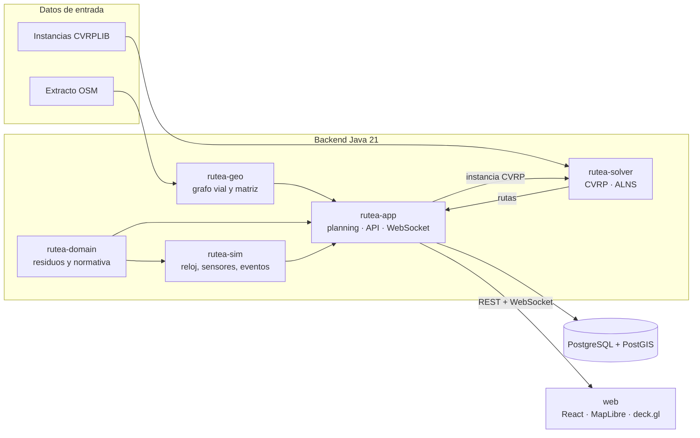
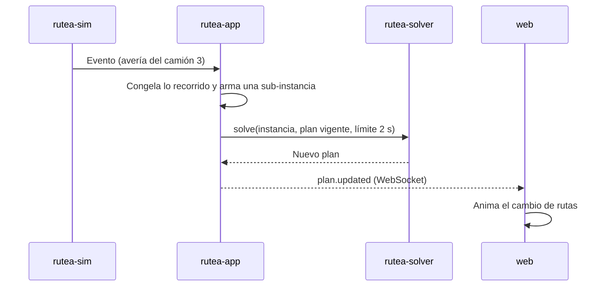

# Arquitectura

Rutea es un **monolito modular**: módulos Maven con fronteras claras y dependencias en una sola dirección, desplegados como un solo proceso. Ver [ADR 0001](adr/0001-monolito-modular.md).

## Vista general

## Módulos

### rutea-solver

Java puro, sin dependencias en tiempo de ejecución.

- Paquete raíz `me.ymid.rutea.solver`: el núcleo que comparten todos los solvers.
  - `Instance` (capacidad, demandas, matriz), `DistanceMatrix` (enteros `nint`, arreglo plano), `Solution` (rutas como `int[]`).
  - `Evaluator` y `Evaluation`: la única fuente de verdad del costo y la factibilidad.
  - `Solver`, `SolverSettings` (semilla, límite de tiempo) y `Solvers`, el registro que leen el arnés y `SolverContractTest`.
  - Constructivos, de una sola clase cada uno: `NearestNeighborSolver` (referencia) y `ClarkeWrightSolver` (ahorros, válido con distancias asimétricas).
- `cvrplib`: lectura de `.vrp` y `.sol` de CVRPLIB.
- `benchmark`: arnés que corre los solvers sobre un directorio de instancias y escribe CSV.
- `local`: búsqueda local. `Routes` guarda las rutas con cargas y costos acumulados (también al revés) para evaluar cada movimiento en O(1); `LocalSearchSolver` arranca desde Clarke-Wright con varios λ y aplica relocate, Or-opt, swap, 2-opt y 2-opt* sobre listas de vecinos.
- `alns`: ALNS sobre la búsqueda local. `Plan` guarda rutas que se pueden vaciar y rellenar sin reservar memoria; `AlnsSolver` quita clientes (al azar, los más caros, Shaw, tramos) y los reinserta (voraz con parpadeos, regret-2), pule con búsqueda local y acepta con recocido simulado. `alns-x4` corre cuatro búsquedas con semillas fijas en paralelo.

### rutea-bench

Comparación externa y microbenchmarks, fuera del solver para que este siga sin dependencias:

- `timefold`: el mismo CVRP modelado en Timefold (variable de lista, capacidad dura, distancia blanda), corrido con su configuración por defecto desde el mismo arnés.
- `jmh`: tiempo de una pasada de búsqueda local sobre un óptimo local (evalúa todos los movimientos sin aplicar ninguno).

### rutea-domain

- `WasteStream`: corrientes de residuo con su color oficial.
- `NormRef`: referencia normativa (norma, artículo, URL, estado de verificación).
- `CollectionRules`: reglas del Decreto 1077 de 2015 que el planificador debe respetar.
- Más adelante: `Container`, `Vehicle`, `Facility` (base, ECA, relleno), `Shift`.

### rutea-geo (F3)

Grafo vial en arreglos compactos (CSR), Dijkstra y A*, y construcción de la matriz de distancias y tiempos. Lee OpenStreetMap con un lector PBF propio y guarda el grafo compilado en un binario versionado ([ADR 0004](adr/0004-grafo-vial-pbf-propio.md)).

### rutea-sim (F5)

Reloj acelerable, sensores de llenado y generador de eventos. Publica en un bus interno que consume `rutea-app`.

### rutea-app

Spring Boot. Paquetes:

- `planning`: traduce el problema de residuos a instancias CVRP y las rutas de vuelta a geometrías.
- `api`: REST (`/api/...`) y WebSocket.
- `persistence`: PostgreSQL + PostGIS (desde F6).

## Flujo de una replanificación (F5)

