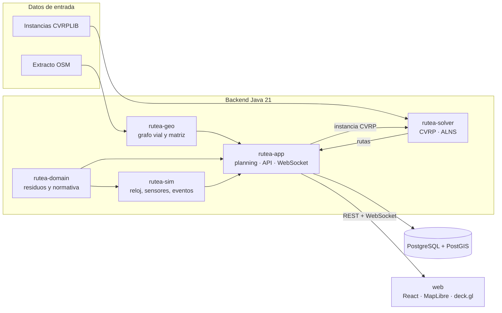

# Arquitectura

Rutea es un **monolito modular**: módulos Maven con fronteras claras y dependencias en una sola dirección, desplegados como un solo proceso. Ver [ADR 0001](adr/0001-monolito-modular.md).

## Vista general



## Módulos

### rutea-solver

Java puro, sin dependencias en tiempo de ejecución.

- Paquete raíz `me.ymid.rutea.solver`: el núcleo que comparten todos los solvers.
  - `Instance` (capacidad, demandas, matriz), `DistanceMatrix` (enteros `nint`, arreglo plano), `Solution` (rutas como `int[]`).
  - `Evaluator` y `Evaluation`: la única fuente de verdad del costo y la factibilidad.
  - `Solver`, `SolverSettings` (semilla, límite de tiempo) y `Solvers`, el registro que leen el arnés y `SolverContractTest`.
  - Constructivos, de una sola clase cada uno: `NearestNeighborSolver` (referencia) y `ClarkeWrightSolver` (ahorros, válido con distancias asimétricas).
- `cvrplib`: lectura de `.vrp` y `.sol` de CVRPLIB.
- `benchmark`: arnés que corre los solvers sobre un directorio de instancias y escribe CSV.
- `local`: búsqueda local. `Routes` guarda las rutas con cargas y costos acumulados (también al revés) para evaluar cada movimiento en O(1); `LocalSearchSolver` arranca desde Clarke-Wright con varios λ y aplica relocate, Or-opt, swap, 2-opt y 2-opt* sobre listas de vecinos.
- `alns`: ALNS sobre la búsqueda local. `Plan` guarda rutas que se pueden vaciar y rellenar sin reservar memoria; `AlnsSolver` quita clientes (al azar, los más caros, Shaw, tramos) y los reinserta (voraz con parpadeos, regret-2), pule con búsqueda local y acepta con recocido simulado. `alns-x4` corre cuatro búsquedas con semillas fijas en paralelo.

### rutea-bench

Comparación externa y microbenchmarks, fuera del solver para que este siga sin dependencias:

- `timefold`: el mismo CVRP modelado en Timefold (variable de lista, capacidad dura, distancia blanda), corrido con su configuración por defecto desde el mismo arnés.
- `jmh`: tiempo de una pasada de búsqueda local sobre un óptimo local (evalúa todos los movimientos sin aplicar ninguno).

### rutea-domain

- `WasteStream`: corrientes de residuo con su color oficial.
- `NormRef`: referencia normativa (norma, artículo, URL, estado de verificación).
- `CollectionRules`: reglas del Decreto 1077 de 2015 que el planificador debe respetar.
- Más adelante: `Container`, `Vehicle`, `Facility` (base, ECA, relleno), `Shift`.

### rutea-geo (F3)

Grafo vial en arreglos compactos (CSR), Dijkstra y A*, y construcción de la matriz de distancias y tiempos. Lee OpenStreetMap con un lector PBF propio y guarda el grafo compilado en un binario versionado ([ADR 0004](adr/0004-grafo-vial-pbf-propio.md)). Al cerrar una vía, la matriz se repara sin recalcularla entera: solo las filas y columnas cuyos caminos pasaban por la vía ([ADR 0007](adr/0007-vias-cerradas.md)).

### rutea-sim (F5)

Reloj de simulación acelerable (`SimulationClock`) y recorridos con la hora de paso por cada punto (`Track`), en Java puro. `rutea-app` los usa para transmitir la posición de cada vehículo por WebSocket ([ADR 0008](adr/0008-reloj-y-posiciones-del-servidor.md)). También el modelo de los sensores de llenado (`FillSensor`, [ADR 0009](adr/0009-sensores-de-llenado.md)).

### rutea-app

Spring Boot, en capas ([ADR 0015](adr/0015-capas-y-herramientas-aparte.md)). Cada paquete importa solo los de abajo, y `LayersTest` lo comprueba:

```
web          → application, planning (DemoPlan)
application  → operations, planning, scenario, persistence
operations   → planning, scenario
planning     → scenario
```

- `web`: los adaptadores. REST (`/api/...`) y WebSocket (`/ws/live/{n}/{franja}`), sin lógica. El contrato está en [`api.md`](api.md) ([ADR 0011](adr/0011-api-estable.md)). `EventsHub` transmite cada `LiveUpdate` que publica la aplicación.
- `application`: los casos de uso. `OperationsService` arma y guarda las sesiones en vivo por localidad y franja, recibe averías, desbordes, cierres y el reloj, y publica lo que cambia. Aquí viven también los tipos que devuelve la API.
- `operations`, `planning`, `scenario`: el modelo, sin Spring. `scenario` arma el problema de residuos (contenedores, puerta a puerta, sectores, sitios sensibles). `planning` lo traduce a instancias CVRP y las rutas de vuelta a geometrías. `operations` replanifica en caliente.
- `persistence`: PostgreSQL + PostGIS ([ADR 0010](adr/0010-un-comando-y-persistencia.md)). Guarda las órdenes de cada turno, que se repiten al arrancar, y cada posición transmitida como punto. Por ejemplo, kilómetros y minutos detenidos por vehículo en el último turno:

  ```sql
  WITH track AS (
    SELECT vehicle, at_seconds, position,
           lag(position) OVER w AS previous, lag(at_seconds) OVER w AS previous_at
    FROM vehicle_position WHERE shift_id = (SELECT max(id) FROM shift)
    WINDOW w AS (PARTITION BY vehicle ORDER BY at_seconds)
  )
  SELECT vehicle,
         round((sum(ST_Distance(position::geography, previous::geography)) / 1000)::numeric, 1) AS km,
         round((sum(at_seconds - previous_at) FILTER (WHERE ST_Equals(position, previous)) / 60)::numeric) AS min_stopped
  FROM track WHERE previous IS NOT NULL GROUP BY vehicle ORDER BY vehicle;
  ```

  Y qué vehículos pasaron a menos de 50 m de un punto: `ST_DWithin(position::geography, ST_SetSRID(ST_MakePoint(lon, lat), 4326)::geography, 50)`. Se corren con `docker compose exec db psql -U rutea`.

### rutea-tools

Los programas de línea de comandos: extractores de OSM y de los operadores, exportadores de instancias `.vrp` y las mediciones de cada fase. Uno por ejecución de `exec-maven-plugin` (`mvn -pl rutea-tools -am compile exec:java@<id>`; la lista está en `AGENTS.md`). Depende de `rutea-app` y nada depende de él.

## Flujo de una replanificación (F5)


